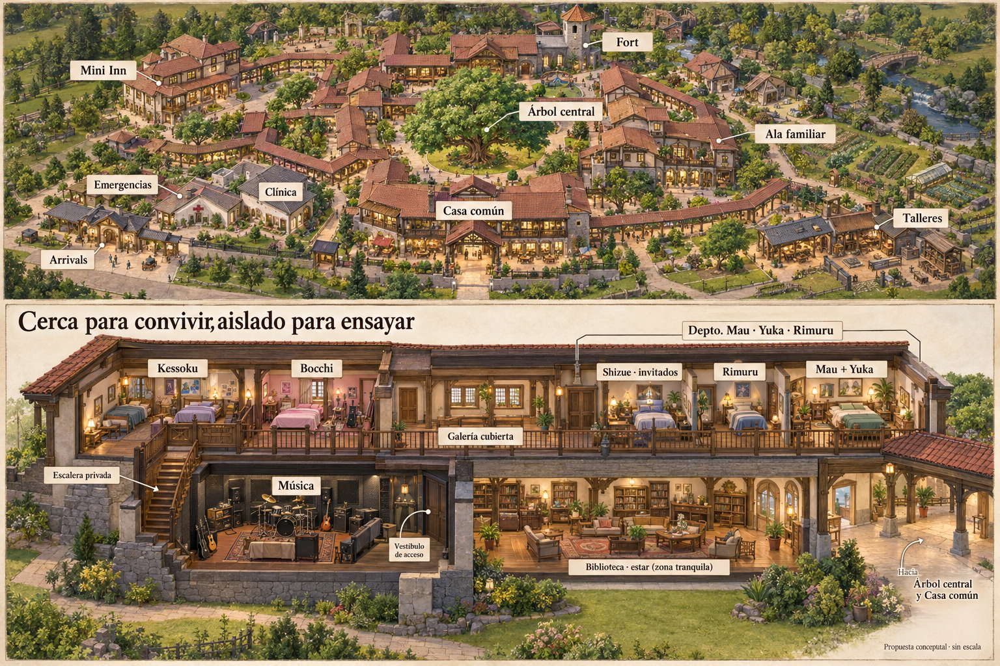

# S8 — Patios conectados: cercanía de Bocchi y edificios para huéspedes/emergencias/arrivals

2026-11-01. Render de concepto para opinión del creador. No plano aprobado, escala medida, censo ni obra ejecutada. Sin capítulos nuevos.

## Mensajes íntegros del creador

> haber haz un render de los patios conectados quiero entenderlo mejor osea pero digamos que bocchi quiere estar cerca de mau y asi respetando lo que ya habiamos planteado el lugar d emusica no le quedaria muy lejos a mau y a bocchi?

> y podemos hacer un mini inn para invitados o gente que no tiene cuarto propio por ejemplo hinata que debido a su chamba no se puede quedar tanto tiempo ahi y tiene que regresar al igual que luminous y una area para emergency y arrivals pueden ser edificios separados

## Lo que corrige esta propuesta

La ubicación de Música en el extremo opuesto del primer diagrama de patios NO debe fijarse como distribución elegida. El creador señala que separaría demasiado a Bocchi de Mau y su espacio de ensayo. No se corrigieron capítulos porque no hay obra nueva narrada.

El layout textual histórico S3_S4_FAMILY_HOUSE_MEGA_INN_LAYOUT_LOCK_2026-10-04.md, §§2 y10.3, ya pide privacidad acústica sin alejamiento emocional: Bocchi cerca del núcleo, Kessoku junto a ella con puerta que puede cerrar, escalera privada hacia música y muros gruesos. Ese documento incluye placements de la línea antigua y posteriores revisiones; no importar a la rama actual la pareja Mau/Frieren ni desalojar a Ori de su vida con Frieren. Aquí se conserva el principio relacional y la escalera, proponiendo una solución nueva para el pueblo.

### Ala familiar propuesta para el render

- Bocchi tiene dormitorio privado cercano a la entrada del departamento Mau/Yuka/Rimuru/Shizue, en la misma galería cubierta del piso alto. No necesita atravesar sus habitaciones ni una plaza entera para visitarlos.
- Kessoku al lado de Bocchi; conexión que conserva elección de abrir/cerrar y privacidad.
- Música en la planta baja de esa misma ala, debajo de Bocchi/Kessoku y no debajo del dormitorio Mau/Yuka. Escalera privada, almacén, vestíbulo y aislamiento para separar sonido del descanso sin exiliar a la banda.
- Departamento común con tres dormitorios: Mau/Yuka juntos con ventana al este; Rimuru separado; Shizue en invitados mientras él aclara sentimientos. No resolver romance mediante una asignación de cama.
- Planta baja tranquila junto a música: estar/biblioteca, con separación acústica y acceso cubierto al árbol y casa común. No mover la forja junto al dormitorio de Bocchi.
- El árbol sigue central con raíces sin edificación. Fort conectado al núcleo familiar al norte; la figura no altera relaciones de Ori, Umaru, Coco y demás, cuyo reparto detallado sigue pendiente de decidir juntos.

## Añadido del creador: estancias temporales y recepción

Propuesta de tres edificios distintos cerca del acceso y conectados por galerías:

1. Mini Inn para visitas y personas sin dormitorio permanente, por ejemplo Hinata y Luminous según sus compromisos. Tener habitación temporal aquí no obliga a mudarse ni cancela vida/trabajo fuera.
2. Emergencias/observación junto a clínica; alojamiento de huéspedes separado del trabajo de cuidados.
3. Arrivals: recepción inicial y alojamiento temporal en edificio propio. No restablecer retrospectivamente como operativa la antigua Arrival House descontinuada; es una propuesta nueva para necesidades del pueblo. La decisión no concede libre entrada ni cambia las reglas de protección. Concretar umbral/acuerdos de acceso al planear la obra.

Shizue conserva el cuarto de invitados del departamento; no se la mueve al mini Inn por este añadido. Mantener recorridos cómodos de visitantes hacia áreas comunes sin convertir la galería de dormitorios en paso público.

## Render de discusión



Imagen generada con la herramienta integrada de imágenes. Vista general arriba y corte explicativo abajo; propuesta visual, no planta arquitectónica. Tamaños, distancias, decoración, ventanas, cantidad de camas/edificios y torreta decorativa del Fort no son especificaciones aprobadas. El Fort sigue siendo espacio de la casa, no fortaleza militar nueva. El corte retira paredes/techo para mostrar interiores; eso no implica dormitorios sin muros o una sala de ensayo abierta al exterior. La protección no se amplía ni se mide con este dibujo.

Ninguna de las tres alternativas iniciales queda definitivamente aprobada por pedir este render. Siguiente paso: opinión del creador sobre cercanía/recorridos, después reparto de familias, fases y condiciones reales de terreno/protección. Conservar el resto del elenco, no sólo los rótulos visibles.

## Prompt íntegro de generación

```text
Use case: stylized-concept / architectural cutaway.
Create a beautiful, highly legible 3D architectural concept render for a warm fantasy family village named "Patios conectados". This is a PROPOSED layout for discussion, not a measured architectural plan. Landscape 3:2, high detail, high resolution. A clean architectural presentation with TWO complementary views in ONE image: upper approximately 60% an elevated oblique aerial rendering of the full compact village; lower approximately 40% a generous close cutaway of the EAST FAMILY WING showing two floors and the actual circulation. Warm timber, light plaster, stone bases, tiled roofs, covered wooden galleries, welcoming daylight, inhabited domestic feeling without named characters. Architecture should be easy to understand, not an epic city/castle. Crisp readable short Spanish labels with fine unobtrusive leaders. Subtle parchment-neutral presentation margin.

SPATIAL PLAN, UPPER VIEW:
One magnificent mature living tree stands at the EXACT social center in a generous open green courtyard. Keep its root circle entirely free of foundations and buildings, no trunk house. The central original family Inn remains as the common house framing this court: dining hall with MULTIPLE modest shared tables, kitchen and lounges. Four or so compact two-storey residential courtyard clusters are close by and linked back to this heart by continuous covered galleries; it feels like a family house expanding into a walkable little village, NOT isolated houses spread across enormous lawns.
On the EAST side immediately next to the central court is the core family wing. Its upper level contains the apartment of Mau, Yuka, Rimuru and guest Shizue, with a separate nearby Bocchi bedroom and adjacent Kessoku bedrooms; distinct apartments/rooms with privacy, joined by a SHORT shared covered upstairs gallery. On ground level of THIS SAME east wing, directly under Bocchi, is the MUSIC rehearsal room; it is NOT a distant music building on the outskirts. Music has a private indoor stair up to Bocchi, thick acoustic enclosure, instrument storage and entry vestibule. Do NOT put the music room directly beneath Mau/Yuka's bedroom. The music wing has direct downstairs covered access to the common dining/lounge and the tree courtyard. Bedrooms are insulated from sound without removing their occupants from family life.
The Fort is connected just to the NORTH of the common hub, a friendly small play / gathering room, not a military fortress; nearby children/family rooms can remain near it. No forced separate franchise neighborhoods.
Toward the entrance side, away from the intimate upstairs family galleries, show THREE distinct small buildings, all joined by covered pedestrian routes:
1 "Mini Inn" for TEMPORARY guests like Hinata and Luminous, welcoming small two-storey lodge with several private rooms.
2 "Emergencias" one-storey emergency care / observation annexe, directly beside an identified "Clínica". Not merged with the guest bedrooms.
3 "Arrivals" small separate reception / assessment and temporary arrival accommodation near the access, with supervised threshold, not open unrestricted entry into homes.
Outer working edge includes small workshop / forge, classes / atelier and kitchen gardens. Do not place a loud forge near Bocchi or family bedrooms. The map may crop or simplify the outer edge; do NOT draw a magical protection boundary as if its measured extent is approved. No huge defensive walls or towers.
Upper view use only these main labels where helpful: "Árbol central", "Casa común", "Fort", "Ala familiar", "Mini Inn", "Emergencias", "Clínica", "Arrivals", "Talleres". Leave generous building-to-label spacing, no crowding.

LOWER VIEW — MATCH THE SAME EAST WING, this is critical, LARGE AND READABLE:
Title: "Cerca para convivir, aislado para ensayar".
Open isometric sectional cutaway, remove roof and near wall, two clear storeys. Upstairs, on right/eastern end, a distinct shared APARTMENT: Mau + Yuka bedroom with EAST-facing window, Rimuru separate bedroom, Shizue separate GUEST bedroom, a shared small sitting room. No shared Rimuru/Shizue bed. Group label "Depto. Mau · Yuka · Rimuru"; within it clear labels "Mau + Yuka", "Rimuru", "Shizue · invitados". On left portion of this same upstairs gallery, a private "Bocchi" bedroom and adjoining "Kessoku" bedrooms with a connecting door. A short highlighted continuous gallery connects Bocchi's door to the shared apartment entry, NOT through anyone's bedroom. Directly beneath Bocchi and Kessoku: labelled "Música", rehearsal room with guitars, drum kit, storage and clearly visible thick acoustic wall and entry vestibule. A clearly VISIBLE private stair links the music room ONLY to Bocchi's upper landing/room. Ground floor below the main apartment can be quiet shared library/lounge, NOT a forge or music stage. Show the covered link going toward "Casa común". Labels "Galería cubierta" and "Escalera privada" if space allows.
Architecture and circulation must genuinely show why Bocchi is nearby upstairs while rehearsing downstairs, NOT just words over unrelated buildings. No metre distances, population totals, modern cars, skyscrapers, oversized stages, random personal room assignments, coats of arms, watermark. Tiny caption "Propuesta conceptual · sin escala". Beautiful polished physical architectural model / fantasy archviz, strong spatial clarity over decoration.

```
